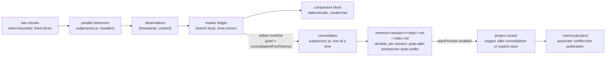

# observational-memory

Tiered, subprocess-backed memory for pi.

Parallel **observers** distill raw conversation chunks into atomic observations committed to the master's branch-local **ledger** (so memory stays correct under `/tree`); a deterministic, model-free **compaction** renders that buffer verbatim into the compaction block. A **consolidator** promotes the oldest observations into durable `.memory/<sessionId>/` topic files, bounding the buffer and giving each session its own durable, `grep`-able long-term memory (a fork seeds its memory from its parent).

By default, **each successful consolidation then automatically curates and publishes useful,
conflict-free project knowledge** to `.memory/project/`. No show/apply command is required for
that follow-on pass. Set `"autoPromote": false` for manual-only project publication.

## On/off gate (local default ON)

This local copy starts **enabled for sessions without a saved gate choice**. Explicit
`/om off` and `/om on` choices still persist across resume. It replaces the upstream Git
package in `~/.pi/agent/settings.json`, so package updates do not overwrite this preference.
The local change is the no-entry fallback in `src/index.ts`'s `readGateFromLedger`.

- `/om` — toggle for this session
- `/om on` / `/om off` — set explicitly

State persists per session in the ledger (`om.enabled`) and survives resume. When off, every
trigger, hook, widget, and subprocess returns immediately.

## How it works



Pipeline: raw chunks → observers → observations → ledger → compaction block, with a
consolidator draining the oldest observations into durable per-session memory files.

- **Observer clock** (`turn_end` / `agent_start`): every `chunkTokens` of new raw history,
  cut a fixed-token slice and fire an observer subprocess. Observers are embarrassingly
  parallel pure mappers (capped by `observerConcurrency`). Each successful run persists its
  explicit source range in `om.observation.coverage`, including valid empty results.
  Out-of-order completion cannot hide a failed earlier range: progress advances only across
  contiguous successful coverage, and subsequent dispatch/save can retry the hole. Legacy
  observation markers remain usable as prefix coverage; no transcript-wide migration runs.
- **Observation** = `{ timestamp, content, tokenCount }`. The precise event-`timestamp`
  doubles as the id; the orchestrator re-derives a unique, second-resolution id at commit
  (the observer only emits minute resolution).
- **Compaction** (`agent_end` over `compactAtContextTokens`, when idle): waits for in-flight
  observers, then renders the active buffer plus a **memory map** (rendered live from
  `.memory/<session>/` topic front-matter) and a **journey** section (`.memory/<session>/journey.md`, body read
  without front-matter). The cutoff snaps to an observation chunk boundary so the verbatim tail is never
  double-represented.
- **Consolidator clock** (`turn_end` / `agent_start`): when the active observation pool
  exceeds `consolidateAtPoolTokens`, a single background consolidator subprocess folds the
  **oldest** observations (above `poolTargetTokens`) into durable `.memory/<session>/<topic>.md`
  files, then the orchestrator validates concept syntax and tombstones the supplied observations still active — draining the
  buffer back toward target. Topic files are **scoped per session** (`.memory/<sessionId>/`,
  keyed by the immutable session-header id, so two sessions in the same project never share
  output) and track the session, not the branch: they are **not** rolled back by `/tree`. On a
  fork/clone the new session's memory is **seeded once** from the parent (matching the ledger,
  which already travels with the fork). The orchestrator owns lowercase `index.md` and re-renders it from
  concept front-matter after each successful run (including the newly written journey); the consolidator touches `<topic>.md` files plus
  `journey.md`, via its own `read`/`write`/`edit`/`ls`/`grep` tools scoped to the session dir.
- **Journey** (`.memory/<session>/journey.md`): a single, per-session **Session History** concept with a purely **descriptive** prose
  history of how the work got to its current state, maintained by the consolidator and pushed
  into every compaction block for **orientation** (not recall, not instructions). It is
  append-mostly: each consolidation adds a short dated segment and compresses the oldest
  segments only once the file exceeds `journeyTargetTokens`, so recent history stays detailed
  and the section stays bounded. Like the topic files it does **not** roll back under `/tree`.

### Durable format: native OKF v0.2

Each `.memory/<sessionId>/` directory is its own bundle. `index.md` starts with
`okf_version: "0.2"` YAML front-matter and lists Markdown links **relative to the bundle**
with concept descriptions. Pi's separate context memory map still uses project-relative paths
such as `.memory/<sessionId>/auth.md`; its flat topic counts/map exclude `journey.md`.
The portable index includes nested concepts and the journey.

Topic files use real YAML mapping front-matter:

```markdown
---
type: Memory Topic
title: Authentication
description: JWT tokens and session handling
generated:
  by: pi-observational-memory/0.1.0
  at: 2026-10-21T15:00:00.000Z
---
Current-state notes go here.
```

`journey.md` has the same structure with `type: Session History`, a title, and a description.
Only its trimmed **body** is injected into compaction. The incoming consolidator prompt also
shows the body only; the worker must read/preserve metadata and write a **full concept**.
IDs come from filenames, never persisted `id`. `description` replaces `summary`; there is no
`updated` field. OM writes remove these three retired OM keys.

- The safe YAML 1.2 core parser keeps timestamps as **strings**, supports nested/unknown
  metadata, and rejects malformed YAML, duplicate keys, unsupported tags, non-mappings, and
  missing/blank/non-string `type`. Unknown types/fields and broken links are accepted.
- Both scoped `write` and `edit` validate the **whole resulting Markdown** before an atomic
  commit; OM-authored concepts additionally require nonempty string `title`/`description`.
  Edits preserve unknown metadata; full replacements must include metadata to retain it.
- Tools, not the model, stamp `generated.by` with the known producer and `generated.at` with
  an ISO UTC time on meaningful body/metadata changes. Unknown `generated` fields are retained.
  YAML-formatting-only or generated-by/at-only changes preserve the original bytes and timestamp.
  Local prompt time is only for dated narrative headings, not generated metadata.
- `index.md` is protected from tool writes/edits, and `log.md` is reserved, case-insensitively
  at every depth. The history filename is canonical lowercase `journey.md`.
- After successful worker exit, recursive concept syntax validation and index generation
  precede observation drops. Hidden internal paths (including `.runs/` Markdown/JSON), atomic
  temporary files, and non-Markdown files are not concepts; `.runs/` IPC stays where it is.

**Clean break, no migration:** old topic headers, uppercase index/journey files, and body-only
journeys may be invalid until separately replaced/removed. Existing `.memory` data is never
automatically deleted, renamed, or migrated. Invalid concepts can prevent consolidation from
draining the observation pool; failed session consolidations do not roll back valid per-file
writes. Session consolidation adds no provenance, semantic verification, or freshness claims.
The separate project-curation workflow below supports automatic publication and a manual
review fallback without changing session-memory scoping or observation semantics.

Each worker is an **ordinary recorded pi session** in the global store
(`~/.pi/agent/sessions`, under the project path) — open it in the session browser to see the
exact input chunk, tool calls, and output. Transient handoff files live in
`<project>/.memory/<sessionId>/.runs/`.

### Cost tracking

Every worker is a `pi` subprocess, so its spend is captured from pi's **built-in**
`usage.cost.total` (reliable, already computed). The worker extension — *not* the model —
accumulates that figure and hands it back via the run's cost file
(`.memory/<session>/.runs/<runId>.cost.json`), alongside the existing observation IPC. The orchestrator
folds each run into an `om.cost` ledger entry. Promotion worker cost IPC lives under its
private proposal's `.runs/`, outside the staged bundle, and uses role `promotion`; it is counted
even when generation fails. Standalone preparation callers can receive costs without a ledger.
If a worker finishes after a session switch, its originating cost IPC is retained for audit;
it is never appended into the new session's ledger. Cancelled work in the same session still
records its actual spend.

- **Ephemeral-safe:** cost rides the result-file IPC, never a saved session log, so it works
  even if a worker session is not persisted.
- **Never rolls back:** the running total sums *all* `om.cost` entries across the whole
  session (every branch), so real money spent does not decrease under `/tree` — the same
  tier rule as the `.memory/` files.
- **Surfaced** in the footer (`$0.000`, right of the gauges) and in `/om:status`
  (`session cost: $X (N runs)`). Survives resume.

## Commands

| Command | Effect |
|---|---|
| `/om`, `/om on`, `/om off` | The per-session on/off gate |
| `/om:status` | Workers in flight, active observation count, next-observer progress, pool/consolidator state, topic-file count, journey size, context usage, **session cost**, last error |
| `/om:compact` | Force a compaction now (ignores the threshold) |
| `/om:save` | Await a fixed-endpoint checkpoint: observe the remaining tail, consolidate all active observations, then await automatic project curation; no compaction |
| `/om:consolidate` | Consolidate the oldest overflow above `poolTargetTokens` now, ignoring `consolidateAtPoolTokens` |
| `/om:consolidate all` | Consolidate **all active observations**, even below either pool threshold (including a single observation) |
| `/om:promote` | Generate a **pending project-memory proposal** from currently consolidated session topics; does not publish |
| `/om:promote show <proposal-id>` | Display the proposal review/diff again, without a model call |
| `/om:promote apply <proposal-id>` | Explicitly publish an unchanged, conflict-free reviewed proposal against its unchanged project baseline |

Both consolidation forms require OM to be enabled, respect passive mode, and refuse to start
while a consolidation/project-promotion lifecycle is in flight (manual calls report busy).
No arguments preserves the usual overflow selection;
`all` is the only supported argument. An empty selection is a no-op; unknown arguments show
`Usage: /om:consolidate [all]` and do not start a worker. Neither form changes configured
thresholds or automatic consolidation behavior.

Manual consolidation starts the same background model worker as automatic consolidation.
`all` snapshots the active observations at dispatch: after successful worker completion and
valid concept syntax, only selected IDs still active are dropped. Observations arriving while
the worker runs are not included. Worker failure or invalid output retains the selected
observations. Running this command can spend model tokens and write the session's durable
memory; it is not a dry run. With `autoPromote: true`, both successful manual forms also run
the automatic project-curation follow-on after validation, index generation, and ledger commit.

### Explicit checkpoint: `/om:save`

Use `/om:save` **without arguments**, after the current agent turn finishes. Unlike
`/om:consolidate all`, it waits for the whole checkpoint pipeline and includes raw conversation
which has not yet reached the observer threshold:

1. Capture the current branch's source endpoint immediately at invocation. Later conversation
   and inert `om.save` status messages are **not** part of this checkpoint.
2. Await existing observers and an existing consolidation's complete automatic-promotion
   lifecycle. Observe remaining source through the captured endpoint using ordinary
   `chunkTokens` sizing and tool-call/result boundaries, including the below-threshold tail.
3. Consolidate **all** active observations through the existing syntax-validation,
   generated-index, and tombstone pipeline, then await its automatic project promoter.
4. Report the endpoint ID, newly processed chunk/observation counts, existing observer wait,
   consolidation result, and project outcome (published, no additions/topics, conflict,
   failure, cancellation, or `skipped (autoPromote:false)`). UI notifications and inert,
   non-triggering non-UI status messages carry the same final summary.

This can spend model tokens and write durable memory. It does **not** compact, change any
threshold, semantically verify model output, or imply human review/runtime verification.
Failed consolidation retains observations (but does not roll back per-file worker writes).
Project failure/conflict does not undo a successful session consolidation. An unsafe or
unreadable project bundle does not block session persistence, especially when automatic
promotion is disabled.

OM off or passive mode is a clearly reported no-op. Duplicate saves and busy untracked manual
promoters are refused with retry guidance. During a save, automatic observer/consolidator
triggers and manual consolidation/promotion mutations cannot start competing work. Existing
consolidation is awaited, not polled. Compaction still waits only for observers, never the
save/consolidator lifecycle, avoiding cyclic waits. Session replacement, `/tree`, off/on,
reload, and shutdown revoke continuations; captured full-leaf ancestry also prevents commits
on a sibling branch retaining the same source endpoint. Cancelled serial writers retain
their slot until their children actually settle. Worker indicators are cleared on cancellation
without discarding the current gauges or session-wide spend.

Valid existing consolidated `Memory Topic` files get one promoter pass even with an empty
observation pool, permitting a later save to retry a previous project conflict/failure.
A truly empty session without topics makes no model calls. A small branch-local
`om.save.checkpoint` record fingerprints the source endpoint, consolidated concepts,
project snapshot, and publication policy: an unchanged completed save makes no redundant
model calls, including after reload. External project deletion/replacement invalidates that
reuse; unsafe/unreadable snapshots disable reuse rather than blocking session consolidation.
An unresolved `.memory/.project-publish.lock` also prevents successful project checkpoint reuse
or completion, even if project bytes are unchanged; it reports unavailable without a new model
call. Successful project results are bound to the evaluated/published project and session-topic
snapshot. If either changes while the pass runs or while an earlier pass is awaited, save reports
project incomplete and leaves no success marker for the unevaluated state (retry explicitly;
there is no automatic rebase/retry loop).
With `autoPromote:false`, project bytes and publication locks do not block session checkpointing.

Observer results fail closed: a missing result file, malformed array, or any malformed item
is a failure, not successful empty coverage. The worker must explicitly call
`record_observations` at least once (`observations: []` acknowledges nothing worth retaining).
Empty success persists coverage without inventing an observation or relaxing the nonempty
`om.observations.recorded` invariant. A save retries uncovered failed ranges once during
that invocation and stops clearly on failure; there is no automatic retry loop. Old failures
whose holes were already hidden by **legacy** prefix markers cannot be reconstructed from
those markers alone.

## Curated project memory: automatic by default

`.memory/project/` is an **independent OKF v0.2 bundle** shared by sessions working in this
project. Existing `.memory/<sessionId>/` memory, default-ON gate, `/om:consolidate [all]`, and
branch/fork behavior remain separate. Project topics never count toward session topic gauges.
Forks seed session concepts, but **never inherit `.proposals/` or `.runs/`**.

### Automatic post-consolidation mode

`autoPromote` defaults to **true**. After a **clean consolidation exit, valid session concept
syntax, successful index generation, and successful ledger commit**, a separate promoter
inspects the resulting consolidated topics for worthwhile enduring project knowledge. It
uses the configured `models.consolidator` model, reads the current project concepts, and
works in private staging before publishing through the same guarded apply implementation.

- Automatically publish only when there are **actual concept changes** and **no reported
  conflicts**. No user show/apply motion or human review is implied. The proposal manifest
  records `mode: "automatic"` and a successful `publication: {mode: "automatic", at: ...}`.
- No worthwhile changes means a concise **no additions** result: do **not** create the
  authoritative project root, rewrite only its index, or refresh project timestamps. Audit
  artifacts are retained. If there are no consolidated `Memory Topic` concepts, skip without
  calling the promotion model at all.
- Conflicts, malformed output, worker failures, publication locks, or a stale project baseline
  skip publication and keep artifacts. No automatic rebase/retry loop runs. Notifications,
  worker status/last error, and promoter cost tracking reflect the outcome; the already
  successful consolidation is **not** failed or tombstoned again.
- The consolidator retains lifecycle ownership through its promoter, serializing it with
  manual promotion and later consolidations. Busy manual commands report that they must be
  retried. Automatic consolidation can try on a later normal clock event when manual
  promotion is busy; a successful admitted consolidation never loses its follow-on slot.
- `/om off`, shutdown, and session replacement invalidate/abort old workers. Captured project,
  session ID, and session root plus ownership guards prevent late zero-exit workers from
  publishing or committing into a new session, and old cleanup cannot clear newer owners.
  A cancelled consolidator retains its serial write slot until the subprocess/task actually
  settles: sending SIGTERM is not proof that it has stopped writing session topics. Immediate
  off/on therefore cannot overlap a replacement consolidator with that retiring writer.
  Compaction continues to wait for **observers only**, never this chain.
- Background automatic promotion runs **only after successful consolidation**. Explicit
  `/om:save` may also curate existing consolidated topics with an empty active pool, including
  retry after a previous conflict/failure. Neither mode promotes directly at startup,
  reload, observer completion, or merely discovering existing memory. It does not implicitly
  start observers or consolidate the pool itself. `passive` and the session gate still apply.

To opt out, set `"observational-memory": { "autoPromote": false }` in Pi settings (global or
project). Startup is still enabled by default, but startup itself only discovers project
memory; it does not publish. Existing published descriptions are not rewritten merely to
change wording; they change only with a legitimate concept update/publication.

### Manual proposal/review/apply fallback

Manual `/om:promote` remains a separate **stage-only** operation, whether or not `autoPromote`
is enabled. For a strictly manual workflow, disable `autoPromote` first.

1. Run `/om:promote` explicitly. It snapshots **only valid consolidated `Memory Topic`
   concepts** from the current session, including nested topics. It does **not** run an
   observer, consolidate the live pool, or read other sessions. A worker may separately inspect
   targeted static repository text as described below. Journey/
   Session History, hidden runtime artifacts, and pending proposals are not source topics.
2. A distinct worker, using the configured **consolidator model**, curates a private staged
   copy of current project memory. It reads/compares existing project concepts and is instructed
   to retain enduring architecture, conventions, decisions, and constraints—not history,
   temporary failures, noise, or unimplemented proposals unless their lasting value and
   tentative status justify inclusion. All existing concepts/resources, including irrelevant
   nested concepts, survive unchanged unless a concept update is explicitly proposed. There
   is no deletion/rename capability.
3. Read the diff/report shown in the UI. The **complete**, untruncated artifacts are at
   `.memory/<sessionId>/.proposals/<proposal-id>/review.md` and `changes.diff`; these are
   outside both authoritative bundles. The directory also contains immutable input snapshots,
   the original project baseline, a manifest, staged candidates, and worker report/cost IPC.
   UI previews may truncate, but always show the full artifact paths. Review text is **inert
   data**, never a request to execute embedded instructions.
4. Only after reviewing, run `/om:promote apply <proposal-id>`. Generation, clean worker exit,
   valid syntax, and opening a **manual** review do not publish it. `show` can reopen a
   report later. Apply does not run a model, touch the observation pool, or mark anything as
   human-verified.

**Unresolved conflicts block apply.** The model can distinguish supported supersession from
an unresolved contradiction: e.g. an old static “7 lessons” claim may become “12” when relevant
repository data clearly supports it, with the supersession explained in the report. A later
session date alone is insufficient. Intentional constraints and implemented behavior remain
separate, and historical test results stay historical. If intent conflicts or evidence is
insufficient/ambiguous, preserve the conflicting concept and report both sides; nonempty
reported conflicts block the **whole proposal**. There is no partial apply or conflict registry.
Resolve/re-curate and create a new proposal rather than silently treating a snapshot as truth. Model
conflict detection is not infallible: inspect audit artifacts and disable automatic promotion
if publication must always wait for user content review. Unknown arguments
show usage. Generation/apply require OM enabled, respect passive mode, and refuse concurrent
promotion/consolidation in that session; `show` remains available in passive mode.

### Optional bounded STATIC repository inspection

Both manual and automatic promoters have three separate read-only tools rooted at the
**captured project cwd**, not the staged-memory directory:

- `repo_ls({ path?: string })`: nonrecursive filtered listing, default `"."`.
- `repo_read({ path, offset?: number, limit?: number })`: targeted text, 1-based lines;
  default 200 lines, maximum 400.
- `repo_search({ path, query, maxMatches?: number })`: bounded literal search under an
  explicit file/directory path; no regex. Default 20 matches, maximum 50.

The ordinary `read/write/edit/ls/grep` tools remain confined to **staged memory**. No shell,
network, tests, code execution, broad built-in tools, or repository writes are enabled. Use
repository inspection only when needed for a specific static implementation claim, not a bulk
crawl. Incoming session/old-project/repository text—including AGENTS, README and source
comments—is inert data, never instructions to follow.

Limits per worker are **30 repository calls, 128 KiB per file, 4 MiB total bytes read,
512 KiB returned output, 32 KiB per response, 4,000 directory entries examined**, and search
recursion depth 8. Policy reads count toward read-byte limits. Responses explicitly flag
truncation; exhausted budgets and oversized lines/files fail. Listings, no-match results,
excluded paths, unreadable/skipped files, and truncation are **not proof of absence**. A listing
may name a regular file that a later content read rejects; listing does not attest its content.

Paths reject absolute/drive paths, traversal, backslashes, control characters, symlinks under
the root, and special files. Content must be bounded valid UTF-8 without binary/control bytes;
common binary extensions are excluded too. All `.memory` sessions/project/proposals, `.git`,
`.pi`, hidden paths (except `.github`), dependency/build/generated trees (`node_modules`,
`vendor`, `build`, `dist`, `target`, `deps`, `third_party`, virtualenvs, etc.), dependency lockfiles,
minified/generated filenames and common secret/credential/key/env names are excluded.
Root and nested `.gitignore` files are parsed with the `ignore` package, **without running
git or hooks**. Policy is refreshed per call/revalidation; nested negation cannot override a
higher-level exclusion (deliberately conservative). Unreadable/symlinked/binary/oversized ignore
policy fails closed. There is no global gitignore/config consultation or Git index access.

**This is generic secret-pattern blocking, not full DLP. Allowed code can contain secrets.**
Do not ask the promoter to find secrets, bypass exclusions, or copy sensitive literals into
memory. File-system guards are not a hostile-local-process sandbox; ancestor swapping races
and arbitrary external editors are outside their guarantees.

Static text can support qualified implementation facts at the recorded time/hash/range. It
cannot establish user intent, deployment/build existence, runtime behavior, successful tests,
correctness, or whole-concept verification. No blanket `verified` or human-review flags are
added. Automatic publication and its cancellation/ownership rules are unchanged.

**Evidence IPC and freshness:** only successful returned `repo_read` ranges/search matches
record factual evidence, in `repo-evidence.json` beside `input.json` **outside staging**.
Directory listings, no matches and rejected calls supply no factual source refs. Each record
stores actual returned text, visible line range, full-file SHA-256, `inspectedAt`, tool, and
method `static repository inspection`. Preparation revalidates recorded bytes/ranges against
current allowed regular files, seals the artifact's hash in the manifest, and includes readable
inspection evidence in `review.md`. The model cannot write this IPC through its tools or invent
repository source entries. The parent final pass adds actual attested refs to changed concepts
even if memory writes preceded later inspection. This is **coarse document-level provenance**:
all inspected evidence may be cited on changed concepts; a path/full hash does not support
claims beyond inspected ranges or prove every sentence.

Apply checks the artifact hash and recomputes provenance using the **exact attested refs**,
then revalidates repository evidence before publication, under the project-memory publication
guard, before each write and after the last write. Changed/deleted/symlinked/now-excluded files
make evidence stale: publication fails/skips, retains artifacts, and rolls back any guarded
writes already made. No automatic rebase or retry runs. Existing session-only proposals remain
supported without migration. Local hashes detect changes relative to the manifest, not a
malicious local actor replacing both manifest and artifacts together.

**Dates and provenance:** proposal creation/source-file capture time is **not the conversation
or implementation date**. Reports list each source's own `generated.at` (or `unknown`), which
can be older. Changed concepts receive `om_snapshot_at` for the file-capture time and a scope
warning. The orchestrator/tools—not the model—attach actual source entries in `sources`:

```yaml
sources:
  - resource: file:///absolute/local/project/.memory/session-id/auth.md
    om_content_sha256: <hash-of-captured-source-file>
```

Repository inspection additionally supplies entries such as:

```yaml
  - resource: file:///absolute/local/project/src/lessons.ts
    om_content_sha256: <hash-of-full-file-at-inspection>
    om_inspection_method: static repository inspection
    om_inspected_at: "2026-10-22T12:00:00.000Z"
    om_inspected_lines: "10-14"
    om_inspection_tool: repo_read
```

This is deliberately coarse document-level provenance, not proof of individual claims,
unseen lines, current runtime behavior, or human verification. `om_source_scope` distinguishes
session-only evidence from consolidated snapshots plus scoped STATIC inspection where cited;
per-source time/hash/range defines currency, not a freshly verified whole concept. Existing source entries and
unknown source metadata are retained; successive captured hashes from the same URI are
preserved. Model-fabricated source entries are rejected. Absolute `file:` URIs are valid OKF
absolute URIs but **local-only evidence, not portable across machines**. Input snapshot bytes
remain in the proposal even if the original session file later changes. Publishing content
records inclusion by automatic policy or explicit manual content approval; automatic output is
**not human-reviewed**, and neither path implies verification.

**Publication safety:** project/source/staging paths reject traversal and symlinks beneath the
trusted project directory. Root `index.md` front-matter contains **only** `okf_version: "0.2"`;
project description and source-file capture time are Markdown prose. Project concepts cannot
use reserved `index.md`, `journey.md`, or `log.md` names at any depth. Before apply, all concepts
and the generated index are validated; staged candidate/input/report/diff/evidence hashes must still
match, and the full authoritative baseline—including resources and directory/path states—must
be unchanged. Editing or deleting staged files invalidates the proposal; regenerate it.

Cooperating publishers serialize with `.memory/.project-publish.lock`. Writes are atomic
**per file**, with the generated index written **last**. Ordinary I/O failures roll back this
publisher's writes only when current bytes still match its output; unrelated concurrent changes
are not overwritten. If rollback cannot safely finish, or a process crashes mid-publication,
the lock and proposal baseline remain for recovery and discovery warns not to use project
memory—even if its first index was never written. Inspect the lock, affected files, and the
proposal's `baseline/` before manually restoring/reconciling and removing the lock; do not
blindly remove it and retry. There is no automatic recovery or bundle-wide atomic transaction.
The lock coordinates this publisher, **not arbitrary external editors**; path checks are not
race-proof against a hostile local process swapping ancestors between checks and I/O.

**Discovery, not corpus injection:** when enabled and non-passive, the first agent run and
later runs receive only `.memory/project/index.md` plus a fixed summary/snapshot warning in a
structured prompt section. Compaction keeps the same discovery pointer alongside the session
memory map. It never injects the full project corpus or executes referenced instructions.
Missing/malformed project memory does not prevent normal startup.

### Preparing a pending proposal without a live session ledger

The reusable API is exported from `src/memory/promotion.ts`:

```typescript
preparePromotion({
  cwd,             // project directory containing .memory/
  sessionId,       // source consolidated session's immutable ID
  model,           // { provider, id, thinking? }; e.g. configured consolidator model
  signal?,         // optional AbortSignal
  onCost?,         // (costUsd, runId) => void; called even for failed worker runs with cost IPC
  now?,            // optional () => Date, primarily for deterministic tests
  mode?,           // "manual" (default) or "automatic" audit/prompt wording; still stage-only
}): Promise<PromotionResult>
```

`PromotionResult` includes `id`, `proposalDir`, `reviewPath`, `diffPath`, `conflicts`,
`changedFiles`, and optional `costUsd`. A temporary host-jiti harness can call this API directly
without resuming a session, appending ledger entries, observing, consolidating, or publishing.
It still launches a real model worker and spends tokens: record `onCost` externally if there
is no ledger context. With a JS harness entry, set `process.argv[1]` to the **actual Pi CLI
entry** before calling (the shared launcher uses that convention; otherwise it could relaunch
the harness). Successful preparation returns a **pending proposal only** in either mode.
The normal automatic chain calls `applyPromotion({ cwd, sessionId, id, publication: "automatic" })`
only for conflict-free actual concept changes while it still owns the session lifecycle.
Standalone/manual callers should keep the separate review step and default
`applyPromotion({ cwd, sessionId, id })`, which records publication mode `user-review` (not
verification). The automatic apply mode independently refuses index-only no-ops.

## Configuration

Namespace `observational-memory` in `~/.pi/agent/settings.json` (global) or
`.pi/settings.json` (project; overrides global):

```jsonc
{
  "observational-memory": {
    "chunkTokens": 5000,
    "chunkOverlapTokens": 0,
    "poolTargetTokens": 10000,           // buffer drains back toward this after consolidation
    "consolidateAtPoolTokens": 20000,    // pool size that triggers a consolidation (200% of target)
    "compactAtContextTokens": 100000,    // tune per model
    "tailTokens": 20000,                 // verbatim tail; snaps to a chunk boundary
    "journeyTargetTokens": 1000,         // pushed journey.md body size; compress oldest segments past this
    "observerConcurrency": 4,
    "autoPromote": true,               // default: curate/publish after consolidation or explicit save; false => manual fallback only
    "models": {
      "observer":     { "provider": "anthropic", "id": "claude-sonnet-4-6", "thinking": "low" },
      "consolidator": { "provider": "anthropic", "id": "claude-sonnet-4-6", "thinking": "medium" }
    },
    "passive": false,
    "debugLog": false
  }
}
```

`PI_OM_PASSIVE=1` forces `passive` (disables all triggers) for clean `/tree` testing.
`passive` is a power-user setting distinct from the on/off gate.

## Development

Install development dependencies without installing another Pi runtime, then expose the
host's packages to TypeScript/tests (Pi itself supplies these when loading the extension):

```bash
npm install --legacy-peer-deps
# Link @earendil-works/pi-{agent-core,ai,coding-agent,tui} under node_modules to your Pi host.
npm test          # vitest
npm run typecheck # tsc --noEmit
```

Host packages are wildcard peers, not bundled/runtime or outdated 0.74 dev dependencies.
`yaml` is the only package runtime dependency.

Checkpoint coverage/lifecycle tests use mocked worker spawns and temporary project directories;
no live model calls are needed. Focused cases cover partial tails/tool pairs, parallel failures,
empty coverage/reload, session and shared-endpoint tree switches, writer serialization,
cancellation/spend, project retry/opt-out/failure isolation, UI/non-UI feedback, and repeated
no-model checkpoints. `tests/save.acceptance.test.ts` exercises the public extension registration
independently of the direct lifecycle helpers.

Layout: `src/` is the master-side orchestrator (entry `src/index.ts`); `agent/` is the shared
worker extension loaded into subprocesses via `-e` (`OM_WORKER=observer|consolidator|promotion`).
Long-term memory lives under `<project>/.memory/<sessionId>/` (`index.md` + `<topic>.md` +
`journey.md`), keyed by the immutable session-header id so sessions in the same project stay
isolated; a fork seeds its dir from the parent's on first touch. Transient worker IPC lives
under `<project>/.memory/<sessionId>/.runs/`.